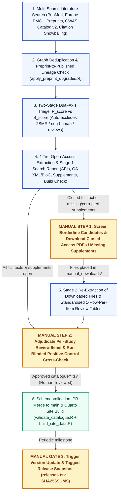

# proteomic-gwas-catalogue

An all-encompassing, continuously updated catalogue and interactive web application of published and preprint genome-wide association studies (GWAS) of proteins — built so researchers can quickly locate, evaluate, and harmonise summary statistics for meta-analysis, Mendelian randomisation (MR), and colocalisation.

Status: unified `v4.1` search and 4-tier extraction pipeline validated; chronological historical backfill (`2000–2025`) in progress.

## Purpose & Scope

Protein GWAS are spread across dozens of papers, preprints, cohorts, proteomic platforms, biological fluids, and data repositories. Unlike static blog tables that edit entries in place or omit operational harmonisation metadata, this catalogue tracks every primary protein GWAS in a version-controlled, machine-readable repository deployed to **GitHub Pages** with **tagged GitHub Releases**:

- **All proteomic technologies:** SomaLogic (SomaScan 1.1k to 11k), Olink (Target 96 / SCALLOP to Explore HT 5k+), mass spectrometry (DIA/SWATH, TMT, nanoparticle-enriched MS), Alamar NULISAseq, and multiplex immunoassays (Luminex).
- **Preprints included:** bioRxiv, medRxiv, and Research Square preprints are tracked alongside peer-reviewed papers and linked cleanly via `superseded_by` once published.
- **No sample-size floor:** Captures everything from small-N tissue, pediatric, urine, and CSF pQTL studies (`N < 100`) up to biobank-scale plasma studies (`N > 50,000`).
- **Operational readiness for downstream genetics:** Records multi-ancestry and sex-specific strata, genome build, *cis*-only vs genome-wide coverage, phenotype transformation and effect scale, signed EAF and indel encoding, cohort membership for overlap checking, and links to `GWASprocessing` YAML manifests.

## Pipeline: Search to Version Update

Automated scripts handle multi-database retrieval, deduplication, secondary-MR filtering, and open-access extraction, while **highlighted manual checkpoints** govern closed-access PDF/supplement downloads, item-by-item ambiguity resolution, blinded positive-control verification, and versioned releases:



- **Blue (`Automated`):** Scripted R + GitHub Actions steps (`src/run_literature_search.R`, `src/extract_candidate_study.R`, `src/validate_catalogue.R`, `src/build_site_data.R`).
- **Amber (`Manual Download / Review / Release Gate`):** Human curator checkpoints documented in each period's standardised `search_report.md` (`Stage 1` manual file downloads → `Stage 2` 1-row-per-item study review + blinded `evaluate_positive_controls.R` check → manual versioned release sign-off).
- **Green (`Validated Catalogue & Website`):** Canonical `catalogue/*.tsv` tables compiled into `site/data/catalogue.json` and deployed to GitHub Pages.

## Repository Structure

- `catalogue/`: Canonical Git-tracked TSV tables (`studies.tsv`, `strata.tsv`, `cohort_membership.tsv`, `proteins_index.tsv`, `search_runs.tsv`, `candidate_queue.tsv`, `excluded_records.tsv`, `releases.tsv`).
- `site/`: Quarto + Observable JS (`ojs`) static web application with five pages:
  1. **Catalogue (`site/index.qmd`):** Full-width 11-column reference table (`AUTHOR`, `YEAR`, `COHORT`, `OVERLAP`, `POPULATION`, `SEX`, `N`, `SAMPLE`, `PLATFORM`, `ASSAY`, `DATA`) with inline per-column filter/search inputs, pagination, click-to-expand inline 3-column detail rows (`PHENOTYPE`, `GENETIC`, `OTHER`), and full-table `.tsv` download.
  2. **Lookup (`site/lookup.qmd`):** Protein-centric typeahead lookup by UniProt accession, gene symbol, or protein name, populating summary KPI boxes, a paginated study table, and an interactive `Year × Sample Size` scatter plot.
  3. **Log (`site/log.qmd`):** Date-stamped search update log (newest at top) with inline-expandable run details and `preprint -> published` replacement tracking.
  4. **About (`site/about.qmd`) & Search Strategy (`site/search-strategy.qmd`):** Pipeline overview, flowchart, eligibility criteria, curation tiers, and full methodological history synced from `docs/methods.md`.
- `src/`: R and shell scripts:
  - `src/setup_quarto.sh`: Installs Quarto CLI into `~/.local/share/quarto` and `~/.local/bin/quarto` (outside OneDrive).
  - `src/simulate_catalogue.R`: Generates the simulated prototype dataset (`unreleased (dev)`).
  - `src/validate_catalogue.R`: Validates primary/foreign keys, controlled vocabularies, and positive-control blinding guardrails (enforced in CI).
  - `src/build_site_data.R`: Validates `catalogue/*.tsv` and compiles `site/data/catalogue.json`.
  - `src/run_literature_search.R` & `src/search/lexicons.R`: Multi-resource discovery engine (PubMed POST, Europe PMC journal + preprint `searchPOST` + `METHODS:` rescue, EBI GWAS Catalog REST v2, and blinded 6-seed citation snowballing), graph deduplication, 4-tier preprint-to-published upgrade detector, and Two-Stage Dual-Axis (`P_score` vs `S_score`) triage scorer.
  - `src/extract_candidate_study.R` & `src/extract/*.R`: 4-tier cascading paper, low-RSS supplementary `.xlsx`/`.docx`/BioC, repository access-gate preflight, sentinel `rsID` coordinate genome-build resolver (`catalogue/schema/sentinel_build_anchors.tsv`), atomic field provenance, and `NEEDS_MANUAL_REVIEW` escalation checklist generator.
  - `src/evaluate_positive_controls.R`: Strictly air-gapped post-hoc evaluator (`--mode blinded-summary`) for testing recall and triage survival against `data/positive_controls.tsv` (git-ignored).
- `.github/`:
  - `workflows/scheduled-search.yml`: PR-gated search + 4-tier staging pipeline (cron paused until final search strategy sign-off; manual `workflow_dispatch` supports targeted `--verify-pmids` tests).
  - `workflows/validate-and-deploy.yml`: Validates `catalogue/*.tsv`, renders `site/`, and deploys to GitHub Pages when enabled.
  - `workflows/release-catalogue.yml`: Manual/tag-triggered workflow publishing versioned TSV/JSON snapshots and `SHA256SUMS` as a GitHub Release only when explicitly requested.
  - `ISSUE_TEMPLATE/`: Structured forms for community submissions and study updates.

## Quick Start

```bash
# 1. Launch local interactive website preview anytime (Ctrl+C to stop)
cd ~/research/proteomic-gwas-catalogue && ~/.local/bin/quarto preview site

# 2. Targeted 2-paper verification of search + 4-tier extraction (no broad search)
Rscript src/run_literature_search.R --verify-pmids 37794186,34857953 --out-dir output/verify
Rscript src/extract_candidate_study.R --queue-file output/verify/candidate_queue_preview.tsv --batch-pending --out-dir output/verify/staging

# 3. Evaluate search recall & triage survival against a blinded positive-control table
Rscript src/evaluate_positive_controls.R --controls data/positive_controls.tsv --dump data/search_dump_<run_id>.tsv --mode blinded-summary
```
